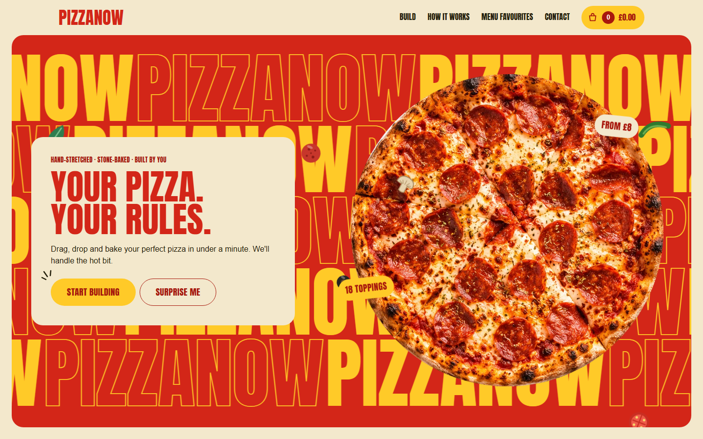

# Pizza builder

A one-page "build your own pizza" site: pick a base, drag toppings onto the pizza, add it to a basket and check out. It started as a design on a Claude design canvas and was then turned into plain HTML, CSS and JavaScript with Claude Code.

## What this shows

- Taking an interactive design from a canvas into a codebase while keeping the look exact: the same colour, type, spacing and radius tokens, layout, copy and motion.
- A drag-and-drop builder with no framework: pointer events for dragging from the tray and moving pieces on the pizza, sprinkling while you drag, double-tap to remove, undo, and limits (8 toppings, ×2 portions) with feedback.
- Small game touches: a "Pizza-o-meter", six unlockable badges, generated pizza names and optional sound.
- A full front-end order flow: review drawer, basket, delivery or collection, UK phone and postcode validation, promo code, a "baking" screen and an order confirmation. Orders are only logged to the console.
- Accessibility basics: real buttons and labels, a live region for every change, focus trapping in dialogs, a tap alternative to every drag, and `prefers-reduced-motion` support.

## Demo



## How it was built

- **Model:** Claude Opus 5.5 in Claude Code.
- **Prompt(s):** the design was made on a Claude design canvas. Claude Code was then given the canvas link and this prompt:

  > Implement this design in this codebase. Read the design's files from that link. Match how it looks, using this codebase's own components and conventions.

- **Transcript:** not shared; it contains links to private design files.
- **Iterations:**
  - The canvas version is a single component with a template language. Here it is split into `index.html` (static markup), `css/styles.css` (the design's styles, unchanged apart from a few additions at the end), `js/config.js` (menu, prices and rules) and `js/app.js` (state and rendering).
  - Re-rendering lists with `innerHTML` broke two things at first: keyboard focus jumped to the page after every click, and every topping replayed its drop animation whenever one was added. `patchHTML()` now skips unchanged markup and restores focus, and pizza pieces are keyed DOM nodes that drop their animation class once it has played.
  - Typing in the special-instructions box would have recreated the textarea on every keystroke, so that field updates state directly without a re-render.
  - When a tile was re-rendered mid-drag, the browser never sent the click that normally follows a drag, so the next tap on a topping was ignored. The flag that swallows that click is now cleared after every drag.

## Run it

**Requirements:** a modern browser. Python 3 is optional, for a local server.

**Steps:**

1. Open `index.html` in a browser, or serve this folder:

   ```bash
   python -m http.server 8081
   ```

2. Go to `http://localhost:8081`, pick a size and start dragging toppings onto the pizza.

To change the menu, prices, delivery fee, promo code or shop name, edit `js/config.js`. To send orders somewhere real, replace `submitOrder()` at the bottom of the same file.

## Notes / limitations

- Front-end demo only. Nothing is sent anywhere, no payment is taken, and the order is printed to the browser console.
- The basket and the pizza in progress are kept in `localStorage`, including an SVG snapshot of each pizza.
- Prices, the `PIZZA10` code, delivery rules and the UK-only validation are placeholders. The shop name `PIZZANOW` and the footer's address, hours and phone number are placeholders too.
- On phones the pizza and the topping tray are stacked, so toppings are added by tapping rather than dragging.
- The photos in `assets/img/` came from the design canvas. Confirm where they came from and that they may be published before this entry is opened as a pull request.

## Dependencies

| Name | Version | License (SPDX) | Source |
| --- | --- | --- | --- |
| Anton (font, loaded from Google Fonts) | Latest served | OFL-1.1 | https://fonts.google.com/specimen/Anton |

## Third-party notices

Google Fonts is a trademark of Google LLC; use here is descriptive and implies no endorsement.
Instagram and Facebook are trademarks of Meta Platforms, Inc.; they are named only as labels on placeholder social links and imply no endorsement.
TikTok is a trademark of ByteDance Ltd.; it is named only as a label on a placeholder social link and implies no endorsement.

---

Shared as-is. Not an official Anthropic product; no support or maintenance is implied. Licensed under the Apache License 2.0; see [LICENSE](LICENSE).
